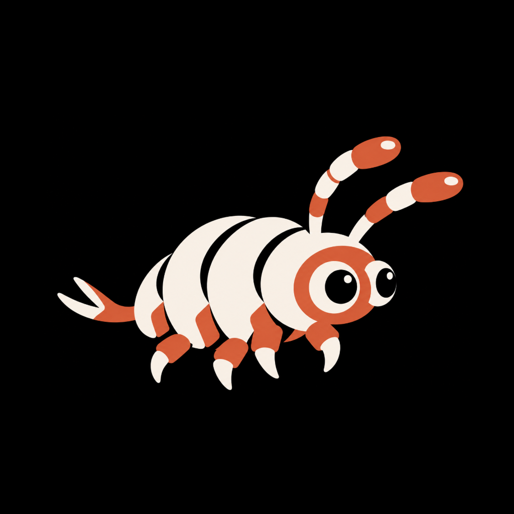

# MORVA



### Form changes. Identity remains.

MORVA is an experimental digital organism built around a simple distinction: **form may change while identity remains continuous.**

> Form changes. Identity remains.

[Website](https://milono.xyz/) · [X](https://x.com/Milono_sol) · [Source](https://github.com/theovarne/morva) · [Build](https://github.com/theovarne/morva/actions/workflows/ci.yml)


Console UI screenshot. Telemetry is a browser-local simulation snapshot.

**Current implementation:** an interactive organism research console, backed by browser-local simulation. The MORVA logo uses the owner-provided ivory and terracotta character with two antennae, two large eyes and a segmented body. The alternative amoebic membrane experiment is retained in source but is **not loaded by the live page**. The screenshot shows the actual current interface, not an unshipped concept.

## What is MORVA?

MORVA explores identity as continuity of origin rather than an unchanging visible shape or uninterrupted process uptime. The research model is a soft computational organism that can respond, contract into dormancy, and reactivate without becoming a different individual.

The visible form is not the identity. Amoebic morphology expresses this distinction through a mutable boundary; the current console models cryptobiosis. Neither metaphor is evidence of biological life or externally verified cryptographic identity.

## Identity and architecture

The proposed private substrate participates in both public identity and internal structure:

```text
PRIVATE SUBSTRATE
        │
        ├──────────────────┐
        ▼                  ▼
    IDENTITY           BODY FIELD
        │                  │
 Ed25519(sk)             HKDF(sk)
        └────────┬─────────┘
                 ▼
               MORVA
                 │
      MORPHOLOGY / RUNTIME
                 │
       CRYPTOGRAPHIC CORE
                 │
        STATE TRANSITION
                 │
       APPEND-ONLY HISTORY
```

This diagram describes the **proposed protocol**, not the browser execution path. The current runtime uses public fixtures, a non-cryptographic pseudo-random generator and bounded local history. It does not derive a secret key, execute HKDF, sign records or enforce append-only storage.

See [Architecture](ARCHITECTURE.md), [Protocol](PROTOCOL.md) and [Identity](docs/identity.md).

## Body Field

Conceptually, `W = HKDF(sk)` defines `W = {w₀, w₁, …, wₙ}`. Field parameters could shape morphology and response. In the active console, specimen identifiers generate repeatable body-node and fingerprint values without a private substrate. The fingerprint has 256 inspectable cells; 18,432 is a conceptual parameter count, not a trained neural network.

The retained amoebic experiment separately maps 18,432 generated values into twelve membrane regions. It is not the active site's body implementation. See [Body Field](docs/body-field.md).

## Mutable Morphology

```text
FORM(t₀) ≠ FORM(t₁)
IDENTITY(t₀) = IDENTITY(t₁)
```

In the current simulation, stress changes the neural-field presentation and lifecycle while the selected fixture's identity, root and commitment remain fixed. In the alternative amoebic renderer, membrane tension, pseudopods and internal flow illustrate mutable form. Those extra visual mechanisms are documented as an experiment, not promised as live-site gestures.

## Cryptographic Core and Motility

A nucleus is a visual representation of identity continuity, not a secure enclave or a claim that living cells perform cryptography. The amoebic experiment uses a persistent nuclear motif, local membrane deformation and activity-dependent flow. The active console represents continuity through shared identity, root, commitment and state readouts.

Motility, membrane stability and internal flow are experimental interface concepts—not measured biology. The current live specimen instead exposes reserve, integrity, epoch and state. See [Organism](ORGANISM.md) and [Morphology](docs/morphology.md).

## Lifecycle and Computational Metabolism

The active runtime supports `ACTIVE`, `UNSTABLE`, `TUN` and `DEAD`. Environmental risk at least 52 marks instability; at least 70 enters TUN. Recovery below 52 enables a requested wake; recovery alone does not wake the specimen. State-model inspection controls are explicit simulation overrides, not protocol verification.

```text
ACTIVE → UNSTABLE → TUN → ACTIVE
       continuity failure → DEAD
```

Reserve models computational cost and resource input:

```text
reserve(t + 1) = reserve(t) - compute_cost + resource_input
```

These are local display metrics, not biological measurements or financial balances. Refresh preserves the current local specimen; switching specimens initializes a new fixture context. See [Lifecycle](docs/lifecycle.md), [Metabolism](docs/metabolism.md) and [Specimens](docs/specimens.md).

## Interaction Model and Research Console

The [live console](https://milono.xyz/) contains:

- Live Specimen and neural Body inspection;
- Identity Trace and Weight Fingerprint;
- Stress Chamber and States;
- Metabolism and Transition Ledger;
- Proof Inspector and Specimen Comparison;
- Laboratory Terminal.

Hovering and clicking inspect nodes, weights and transitions. Stress controls and Terminal commands change shared simulation state, rather than merely changing a CSS hover style. The MORVA mascot is artwork; membrane dragging, pseudopods and elastic release belong to the retained **inactive amoebic experiment**.

See [Interaction](INTERACTION.md) for the real input map and [Simulation](SIMULATION.md) for the trust boundary.

## Terminal

```text
morva@organism:~$ status
morva@organism:~$ inspect identity
morva@organism:~$ inspect body
morva@organism:~$ inspect weights
morva@organism:~$ inspect metabolism
morva@organism:~$ inspect history
morva@organism:~$ stress 0.72
morva@organism:~$ stress 0
morva@organism:~$ wake
```

Use `help` for the implemented command list. `inspect membrane`, `inspect core` and `inspect motility` are **not supported** by the active parser. `LOCAL PASS` means a simulated result, not a proof. Full commands, outputs and limitations: [Terminal reference](docs/terminal.md).

## Run Locally

Moving development machines: [Windows to Mac handoff](MAC_HANDOFF.md). That document preserves the historical migration state; the current brand is MORVA. Existing `MILONO_*` environment variables, `window.Milono` and the `milono.simulation.v2` browser-storage key remain compatible.

Native HTML, CSS, JavaScript and Canvas 2D. No backend, framework runtime, wallet or application environment variables are required.

Use Node.js 22+ and npm:

```bash
git clone https://github.com/theovarne/morva.git
cd morva
npm ci
npm run build
npm run dev
```

Open `http://localhost:4173`. The editable static source is intentionally in `dist/`; `build` validates it rather than bundling a second copy. Do not ignore or relocate `dist/`.

For browser tests:

```bash
npx playwright install chromium
npm test
```

CI performs locked installation, build validation, Chromium tests and full-history secret scanning. There is no fictitious lint command or deployment credential in CI. See [Development](docs/development.md).

## Documentation

| Question | Reference |
| --- | --- |
| How is it composed? | [Architecture](ARCHITECTURE.md) |
| What would verified continuity require? | [Protocol](PROTOCOL.md) · [Identity](docs/identity.md) |
| What makes this an organism model? | [Organism](ORGANISM.md) · [Morphology](docs/morphology.md) |
| How does input affect the console? | [Interaction](INTERACTION.md) · [Terminal](docs/terminal.md) |
| What is simulated? | [Simulation](SIMULATION.md) |
| How do field, state and history work? | [Body Field](docs/body-field.md) · [Lifecycle](docs/lifecycle.md) · [Ledger](docs/transition-ledger.md) |
| How do I contribute? | [Contributing](CONTRIBUTING.md) · [Changelog](CHANGELOG.md) |

## Status

MORVA is an experimental research implementation. All organism telemetry, proof state and transitions shown by this console are local simulation. Fixture generation is repeatable; a whole session is not deterministic because input, timestamps, storage and viewport vary.

There is no connected blockchain provider, live Solana execution, production Ed25519/HKDF implementation, ZK verifier or autonomous external agent. `ChainProvider` is an unconnected stub. Local history is editable and bounded, not tamper-evident.

## Security

Never enter or commit private keys, wallet seeds, credentials or deployment tokens. Secret scans and browser tests do not constitute a security audit. See [Security](SECURITY.md) and [publication review](docs/repository-audit.md).

## License / Attribution

The project owner confirmed the right to publish and license the original website code and organism images, and authorized continued use of the existing [MIT License](LICENSE). This is an owner attestation, not an independent rights audit. Third-party dependencies retain their own licenses; GitHub/X marks are excluded from the project's grant. See [Third-party notices](THIRD_PARTY_NOTICES.md).
